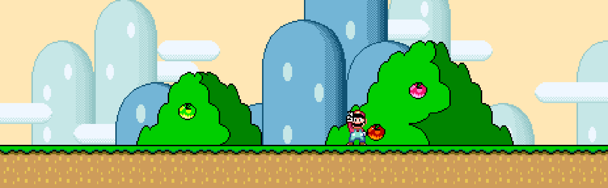
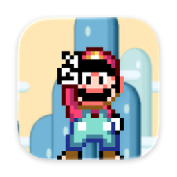
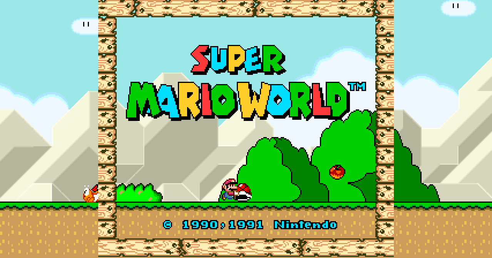
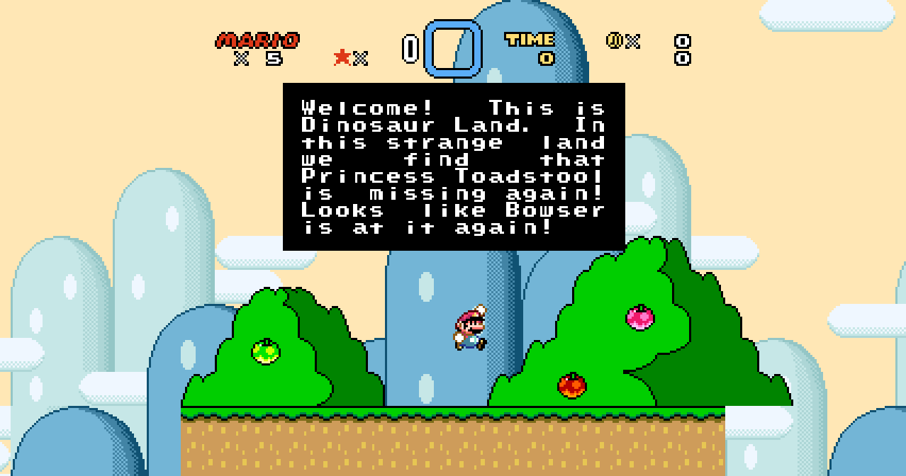
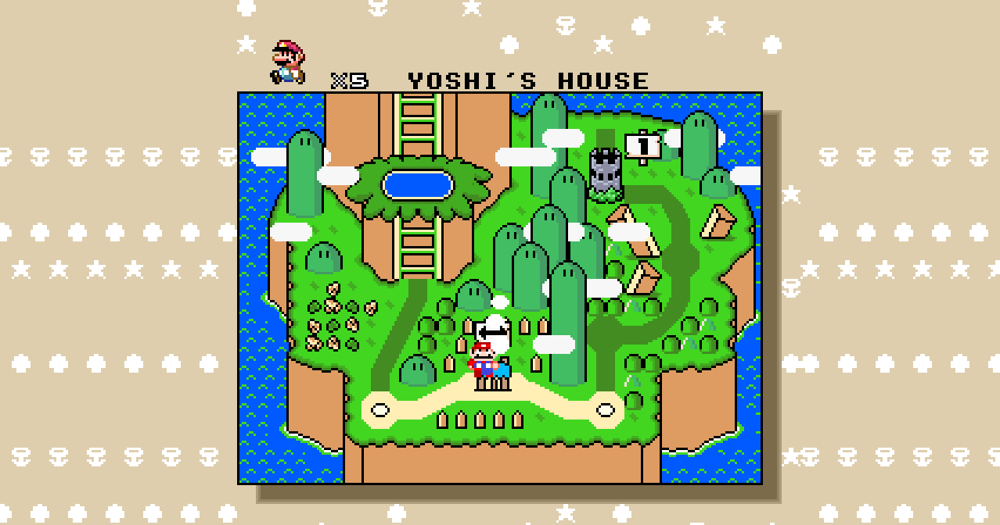
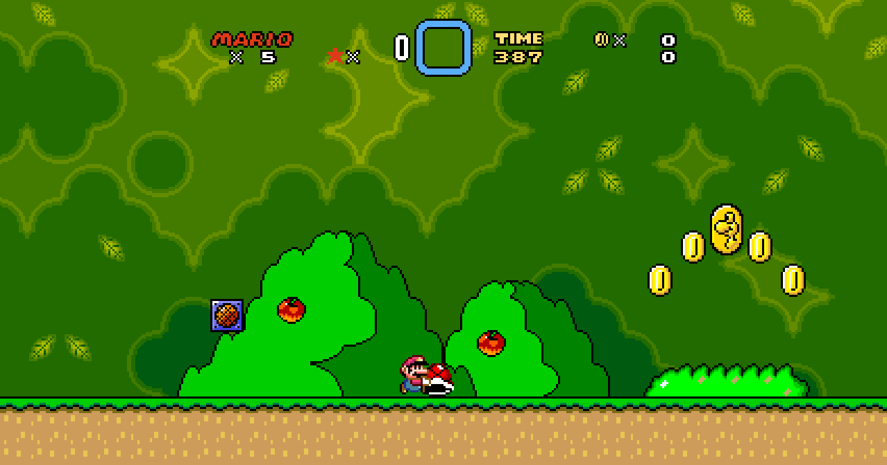
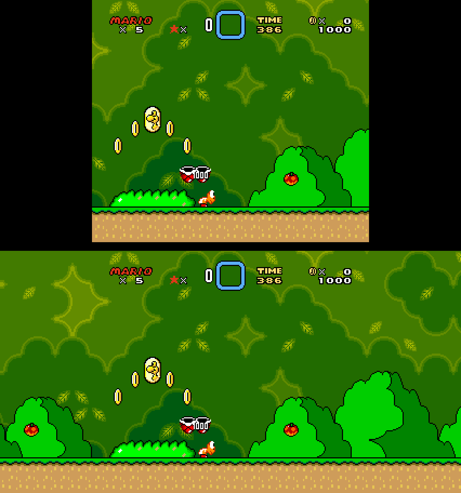
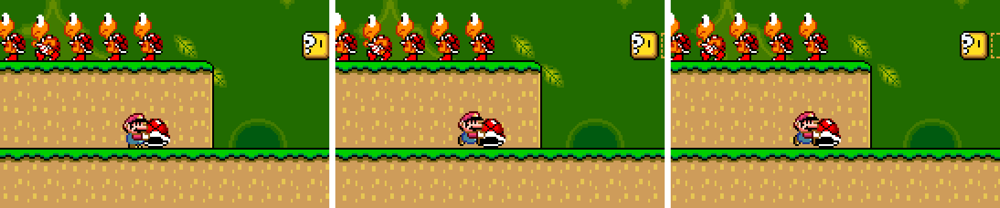

<p align="center">
  
</p>

<h1 align="center">
  <br>
  Super Mario World — Remaster nativo para Apple
</h1>

<p align="center">
  
  
  
  
</p>

<p align="center">
  O Super Mario World original, montado byte a byte a partir da disassembly
  <a href="https://github.com/IsoFrieze/SMWDisX">SMWDisX</a> e executado por um runtime nativo escrito do zero,
  com uma camada de remaster que não muda nada do jogo: <b>4K</b>, <b>HDR / Dolby Vision</b>, <b>widescreen real</b>,
  <b>120 Hz</b>, <b>controles Bluetooth</b>, <b>Game Center</b> e <b>multijogador por SharePlay</b>.
</p>

---

## 🍄 Como fica

| Título (widescreen) | Introdução em Dinosaur Land |
| :---: | :---: |
|  |  |
| **Mapa-múndi** | **Yoshi's Island 2** |
|  |  |

Todas as imagens desta página foram geradas pelo próprio runtime (o *harness* headless), não são capturas de
emulador.

### ⭐ Widescreen de verdade, sem barra preta

<p align="center"></p>

Em cima, o quadro original; embaixo, o mesmo instante em 16:9. A rotina `CODE_05877E` (bank 05) mostra que o
jogo mantém carregadas na VRAM colunas da fase de **8 tiles à esquerda até 23 à direita** da câmera. O PPU usa
essa área para desenhar as laterais. O centro de 256 px continua bit a bit idêntico e a avaliação de sprites
segue as regras do hardware. Os limites de cada cena saem dos `GameMode` do `rammap.asm`: fora dos limites da
fase só o fundo continua, e HUD e molduras ficam no centro.

### 🌟 120 Hz sem mudar a física

<p align="center"></p>

A lógica do jogo continua a 60 quadros por segundo. Para telas ProMotion, o PPU grava o estado de vídeo linha a
linha e redesenha a cena com scroll e sprites **no meio do caminho** entre dois quadros reais (no centro da
imagem acima). Não é interpolação por estimativa de imagem, então não há artefatos.

## 🪙 O que foi feito

| Área | Detalhes |
| --- | --- |
| **Runtime SNES próprio (C11)** | CPU 65C816 com custo de ciclos por acesso (lag e raster fiéis), SPC700 + S-DSP (BRR, ADSR/GAIN, eco FIR, ruído, pitch mod), PPU por scanline (modos 0–4 e 7, limites de sprites, janelas, color math, mosaico), DMA/HDMA e IRQ/NMI. Roda a mais de 600 fps sem tela. |
| **4K** | Upscale na GPU direto para a resolução do painel (até 3840×2160) com *sharp bilinear*, *Scale4x* ou CRT (feixe por scanline, máscara de abertura, curvatura). |
| **HDR / Dolby Vision** | EDR em `rgba16Float` / Display P3 no iPhone, iPad e Mac; HDR10 PQ / BT.2020 no Apple TV, que pede à TV o modo Dolby Vision a 60 Hz via `AVDisplayManager`. Expansão só dos realces, com o branco de referência em 203 nits. |
| **Controles** | DualSense (luz vermelha do Mario, gatilhos adaptativos, PS/touchpad abrem o menu), Xbox, Switch Pro, MFi, Siri Remote e teclado, com mapeamento posicional igual ao do SNES. Controles de toque multitoque em Liquid Glass no iPhone/iPad. |
| **Vibração ligada ao jogo** | Os IDs de som que o jogo manda ao SPC700 (`constants.asm`) disparam padrões Core Haptics: pulo, pisão, chute, terremoto, morte. |
| **Saves à prova de perda** | O save do cartucho é gravado no quadro seguinte ao jogo salvar, em arquivo + 3 backups + `UserDefaults` + iCloud. A mescla é feita por arquivo do jogo, validando o checksum `$5A5A` do SMW e escolhendo o arquivo com mais saídas concluídas. Apagamentos feitos no jogo são respeitados. Save states são comprimidos (LZFSE), versionados e nunca voltam o save do cartucho. |
| **Game Center** | Conquistas tiradas do progresso real (saídas, switch palaces, cada Koopaling, Bowser, 5 moedas de dragão) e placar de pontuação. |
| **Multijogador online** | Modo 2 jogadores (Mario e Luigi) por **SharePlay** ou partida do **Game Center**, com *rollback netplay*: só os botões trafegam, o jogo é determinístico, e quando a previsão erra o jogo volta por save state e reaplica os inputs. Checksums da RAM detectam e corrigem dessincronias. |
| **Conforto** | Fundo com rolagem sub-pixel (camadas de paralaxe deslizam na velocidade real em vez de andar aos trancos de 1 px), run-ahead (menos latência), rebobinar, avanço rápido, 6 slots com miniatura, retomada de onde parou, áudio HD opcional, vidas infinitas opcionais (desligadas por padrão; fora do online). |

## 🧰 Tecnologias

- **C11** para o runtime, **Swift 6** (concorrência estrita) e **SwiftUI** para o app
- **Metal 4** (`MTL4CommandQueue`, argument tables, residency sets, compilador MTL4), com Metal clássico no Apple TV e no simulador; framebuffer zero-copy em memória unificada
- **AVAudioEngine** com render block em tempo real e ring buffer lock-free em C
- **GameController**, **Core Haptics**, **GameKit**, **GroupActivities** (SharePlay), **NSUbiquitousKeyValueStore**
- **Icon Composer** (ícone em camadas Liquid Glass) e brand assets em camadas com parallax no tvOS
- **XcodeGen**, **Xcode Cloud** e **TestFlight**
- [**asar**](https://github.com/RPGHacker/asar) para montar a disassembly; **Swift Testing** para os testes

## 🗺️ Arquitetura

```
SMWDisX/      submodule: disassembly original (fonte da verdade)
scripts/      montagem da ROM, símbolos do rammap → C, geração de ícones
Core/         runtime em C: cpu, spc/dsp, ppu, widescreen, interp, saves
Engine/       SMWEngine (Swift): Metal, áudio, controles, Game Center, netplay, UI
App/          app multiplataforma (um único target), ícones
Harness/      executável headless para testes, capturas e extração de arte
ci_scripts/   Xcode Cloud
```

Os endereços de RAM usados pelo app (`GameMode`, `Layer1XPos`, `ExitsCompleted`…) não estão escritos à mão:
`scripts/gen_symbols.py` lê o arquivo de símbolos gerado pelo asar e cria `Core/include/smw_symbols.h`.

## 🔨 Compilar

```bash
git clone --recursive https://github.com/byescaleira/super-mario-world.git
```

```bash
brew install cmake xcodegen
```

```bash
./scripts/build_rom.sh
```

```bash
open SuperMarioWorld.xcodeproj
```

`build_rom.sh` compila o asar, monta `Generated/smw.sfc` a partir do SMWDisX (SHA-1 `6b47bb75…`, idêntico ao
cartucho americano) e gera os símbolos. O Xcode repete esse passo em cada build e embute a ROM no app. Se você
alterar `project.yml`, rode `xcodegen generate`.

Testes do runtime e dos saves:

```bash
swift test
```

### ☁️ Xcode Cloud → TestFlight

`ci_scripts/ci_post_clone.sh` prepara o clone (submodule, CMake e ROM) e `TestFlight/WhatToTest.*.txt` traz as
notas de teste. No Xcode: **Integrate → Create Workflow** com a ação *Archive* (iOS, macOS e tvOS) e
pós-ação *TestFlight Internal Testing*.

### 🏆 Game Center (App Store Connect)

Crie estes itens em **App Store Connect → seu app → Game Center** com os mesmos IDs:

| Tipo | ID | Quando desbloqueia |
| --- | --- | --- |
| Conquista | `smw.exits.first`, `smw.exits.half`, `smw.exits.all` | 1, 48 e 96 saídas (`ExitsCompleted`) |
| Conquista | `smw.switch.green`, `smw.switch.yellow`, `smw.switch.blue`, `smw.switch.red`, `smw.switch.all` | Switch palaces (`SwitchBlockFlags`) |
| Conquista | `smw.castle.iggy` … `smw.castle.larry` (iggy, morton, lemmy, ludwig, roy, wendy, larry) | Cena do castelo destruído (`CutsceneID` 1–7) |
| Conquista | `smw.bowser` | Créditos finais (`CutsceneID` 8) |
| Conquista | `smw.dragoncoins` | 5 moedas de dragão numa fase |
| Placar | `smw.score` | Pontuação (`PlayerScore` × 10) |

## 🎮 Controles

| Ação | DualSense | Xbox | Teclado |
| --- | --- | --- | --- |
| Pular | ✕ | A | Z |
| Pulo giratório | ○ | B | X |
| Correr / pegar | □ | X | A |
| L / R | L1 / R1 | LB / RB | Q / W |
| Start / Select | Options / Create | Menu / View | Enter / Tab |
| Rebobinar / avançar | L2 / R2 (gatilhos adaptativos) | LT / RT | Backspace / ` |
| Menu de pausa | PS ou touchpad | Xbox | Esc |

## 🏰 Créditos e aviso

- **Super Mario World** © 1990–1991 Nintendo. Mario, Luigi, Yoshi e Super Mario World são marcas da Nintendo.
  Este é um projeto pessoal, sem fins comerciais e sem relação com a Nintendo; nenhuma ROM é distribuída neste
  repositório.
- [SMWDisX](https://github.com/IsoFrieze/SMWDisX) por IsoFrieze, mikeyk, loveemu, kaizoman666 e contribuidores.
- [asar](https://github.com/RPGHacker/asar) por RPGHacker e Alcaro.
- Runtime, remaster e app por [@byescaleira](https://github.com/byescaleira).
